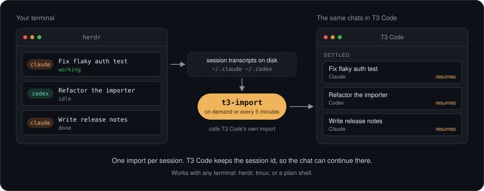

<p align="center">
  
</p>

<h1 align="center">herdr-t3-import</h1>

<p align="center">
  See the Claude Code and Codex chats from your terminal in <a href="https://github.com/pingdotgg/t3code">T3 Code</a>.
</p>

<p align="center">
  <a href="https://github.com/daniel7an/herdr-t3-import/actions/workflows/test.yml"></a>
  
  
  
  
  <a href="LICENSE"></a>
</p>

You run agents in a terminal (herdr, tmux, a plain shell) and want the same chats in T3 Code. T3 Code can import terminal sessions, but only from its first-run wizard ([t3code#10961](https://github.com/pingdotgg/t3code/issues/10961)). `t3-import` calls the same server RPC the wizard uses, so you can run it whenever you like, from herdr, or on a timer.

One Python file, standard library only.

## Install

Install it on the machine that hosts the T3 Code server. `login` needs the `t3` command-line tool, which comes with the headless server install (`t3 serve`, `t3 service install`). The desktop app alone does not put `t3` on your PATH; in that case pass a token in `T3_IMPORT_TOKEN`.

**As a herdr plugin**

```sh
herdr plugin install daniel7an/herdr-t3-import
```

This adds two actions: **T3 Code: import terminal sessions** and **T3 Code: list importable directories**.

**Standalone**

```sh
git clone https://github.com/daniel7an/herdr-t3-import
cd herdr-t3-import
```

## Use

```sh
python3 t3_import.py login                # once: issues a T3 Code access token and stores it
python3 t3_import.py scan                 # read-only: directories that have sessions
python3 t3_import.py import               # import into every existing T3 Code project
python3 t3_import.py import ~/code/myrepo # or just one project
```

`import` only fills projects that already exist in T3 Code. Add one with `t3 project add <dir>`.

Running it again is safe: sessions already in T3 Code are skipped.

```
$ python3 t3_import.py import
myrepo: 14 sessions in T3 Code, 0 skipped  (/home/me/code/myrepo)
```

## What you get

- One T3 Code thread per session, with the chat history, in the project's **Settled** shelf.
- T3 Code stores each session id, so a message you send in that thread continues the original session with its full context.

Continuing a chat is done by T3 Code, not by this tool; only the import itself has been verified. [t3code#15243](https://github.com/pingdotgg/t3code/issues/15243) reports that on T3 Code builds newer than 0.0.45, the first follow-up in an imported Claude Code thread fails; Codex threads are reported unaffected.

## Every 5 minutes

Linux, as a systemd user timer:

```sh
cp systemd/t3-import.* ~/.config/systemd/user/   # edit the path in the .service first
systemctl --user daemon-reload
systemctl --user enable --now t3-import.timer
```

Anywhere else:

```sh
python3 t3_import.py watch --interval 300
```

## Limits

These come from T3 Code's importer, not from this tool.

| Limit | What it means |
| --- | --- |
| One-time copy per session | Turns you add in the terminal after the import do not appear in the T3 Code thread. The model still has them when you continue in T3 Code. |
| Recent sessions only | Sessions idle for more than 30 days are ignored. Each run imports at most 100 new ones, so a large backlog takes a few runs. |
| Newest 5000 transcripts per provider | If batch jobs (`codex exec`, `claude -p`) write thousands of transcripts, older interactive sessions fall outside the window and are not found. |
| No filter | Every session whose working directory is the project root becomes a thread, batch runs included. |
| One writer at a time | Do not drive the same session from the terminal and T3 Code at once. Both write to the same transcript. |

## How it works

1. `login` runs `t3 auth session issue` to get a bearer token for the local T3 Code server.
2. Each run trades the token for a one-time WebSocket ticket and opens T3 Code's RPC socket.
3. `scan` calls `agentSessions.scan`. `import` calls `agentSessions.import` once per project.
4. T3 Code reads the Claude Code and Codex transcripts itself, creates the threads, and stores each session id so it can resume.

Nothing is written to T3 Code's database directly, and transcripts are never modified.

## Access token

`login` saves the token to `~/.config/t3-import/token` (mode 600, default lifetime 90 days). Revoke it with `t3 auth session list` and `t3 auth session revoke`. You can also pass a token in `T3_IMPORT_TOKEN`.

## Status

Tested against T3 Code 0.0.45 on Linux, with the T3 Code server running as a background service. macOS is untested beyond the unit tests. T3 Code is alpha and this RPC is internal, so a T3 Code update can break the tool. If it does, please open an issue with the output of `python3 t3_import.py scan`.

```sh
python3 -m unittest -v   # tests run against a fake T3 Code server
```

## License

MIT
